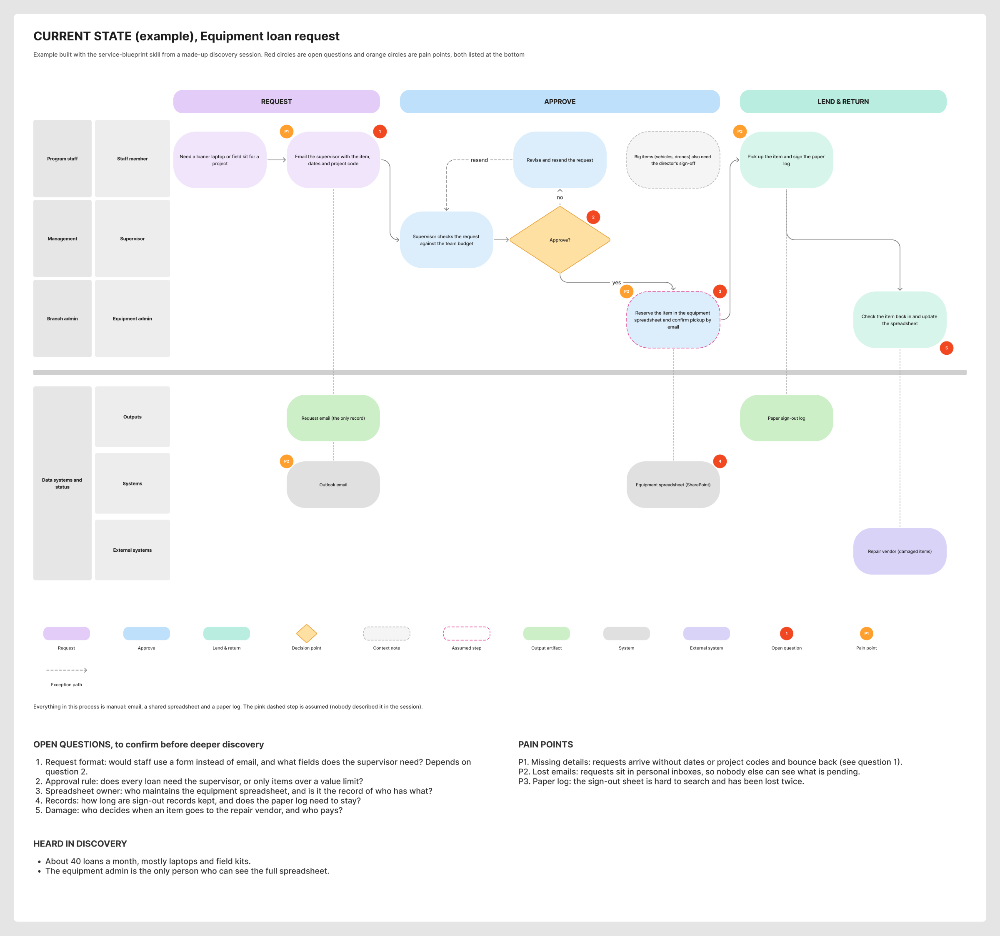

# Service Blueprint

A skill for Claude Code that builds **service design blueprints in FigJam**: swimlane current-state and future-state maps of a business process. It draws them from discovery session transcripts, requirements docs, client diagrams and form schemas.

Every board follows one consistent visual system: phase bars across the top and a lane for each role, with steps on a column grid that reads left to right. Outputs, systems and external parties sit below a divider. Numbered markers for open questions, pain points and open design decisions are keyed to lists under the diagram, and they're always numbered in board order. That way the markers become the agenda for the next working session with the client.



*An example current state built with the skill from a made-up discovery session.*

---

## What it does

- **Current states:** what happens today, workarounds included. Red numbered open questions, orange P# pain points.
- **Future states:** adds the automation or platform lane and the systems the proposal relies on. Red numbered open design decisions, and green P# markers wherever a current pain point gets fixed.
- **Revisions after a review (v2):** keeps v1 for diffing, marks answered questions green, and adds a "what changed" list.
- **Scope checks:** checks a future state against the agreed scope and the latest answers before redrawing anything.
- **Renumbering:** a script that renumbers markers and their lists in board order, and rewrites references like "decision 7" in the rest of the board. It previews every change before applying it.

It plans the layout as a short written brief before it touches Figma, then builds in about five passes. It finishes by checking screenshots for cut-off text, stray connectors and lists that don't match their markers.

## Requirements

- **Claude Code** (terminal, desktop app or IDE extension).
- **The Figma MCP server with write access.** Add it, then sign in when Claude Code asks:

  ```bash
  claude mcp add --transport http figma https://mcp.figma.com/mcp
  ```

- **Figma's `figma-use` and `figma-use-figjam` skills.** These come with Figma's plugin for Claude Code. Without the plugin, Claude can read them from the Figma MCP server.
- **Edit access to the FigJam board** for the Figma account you signed in with.

## Install

```bash
git clone https://github.com/nickwolf99/service-blueprint.git ~/.claude/skills/service-blueprint
```

Restart Claude Code, then ask "what skills do you have". `service-blueprint` should be in the list. To update later, run `git pull` inside that folder.

## Use it

Give it your sources and a board. For example:

> Here's the transcript from our discovery session with the records team. Build a current-state blueprint in this FigJam board: https://www.figma.com/board/...

> Turn that current state into a future state with an n8n workflow lane, and list the open design decisions.

> We reviewed v1 with the client and here are their answers. Make a v2 below it.

> Check the future state against this scope list and tell me what's missing.

> Renumber the markers on this board so they go left to right.

## What's inside

| File | What it's for |
|---|---|
| `SKILL.md` | The workflow: sources, brief, build, numbering, checks, hand-over, revisions |
| `scripts/blueprint-helpers.js` | Paste-in helpers for `use_figma`: grid, colours, steps, diamonds, connectors, markers, legend, lists |
| `scripts/renumber-markers.js` | Board-order renumbering of markers, lists and references, with a dry run |
| `references/visual-spec.md` | Exact sizes, colours, fonts and node naming |
| `references/content-guide.md` | What goes on each kind of board, and how to phrase steps, questions, pain points and decisions |
| `references/figjam-gotchas.md` | Figma Plugin API traps: connector coordinates, sections, cloning, text and lists |
| `assets/brief-template.md` | The layout brief Claude fills in before building |

## Make it yours

The look and the house style live in plain text files, so you can change them:

- **Colours, sizes, fonts:** edit `COLORS` and `G` at the top of `scripts/blueprint-helpers.js`, and keep `references/visual-spec.md` in step.
- **Writing rules** (no em dashes, no full stops on headings, steps under 175 characters): edit the "Writing rules" sections in `SKILL.md` and `references/content-guide.md`.

## Notes

- FigJam boards only, not Figma Design files.
- Tested in October 2026 with Claude Code and Figma's remote MCP server.

## Licence

MIT. See [LICENSE](LICENSE).
